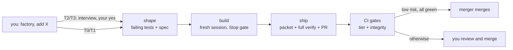

# factory-core

A small software factory for Claude Code. **Tell Claude what you want, answer its questions when the change is
risky, and review the pull request.** In between, the factory works unattended. It files the issue, writes failing
acceptance tests, builds the change in a fresh session, verifies it, and opens a PR with evidence attached. The
process scales with the change's risk. Scripts and CI do the checking, not Claude judging its own work. Low-risk
changes can merge themselves; you keep intent, approvals and every other merge.

factory-core is a thin shell over your own Claude Code setup: your model, effort, permission mode, reviews, spec
workflow and handoff notes. It never edits your Claude Code settings.

> **Status (2026-11-28):** Phases 0–3 are built and have been proved on a test repo only, not yet in real use. Phase
> 4 and later are planned. The status, what's left and the known debts are in [`FACTORY_BRIEF.md`](FACTORY_BRIEF.md)
> section 5.

## In one picture


| Part | What it does |
|---|---|
| **Plugin** (`factory@factory-core`) | Skills `/factory:idea`, `/factory:shape`, `/factory:onboard`; hooks that keep unattended sessions honest |
| **`fx`** | Worktrees, one background session per phase, verify, ship, clean, status |
| **CI gates** | Compute each PR's risk tier and check its integrity, from the default branch |
| **Merger** (optional) | Merges agent PRs at or under the auto-merge ceiling when every check is green |
| **Metrics** | Tokens and honesty per change (`ledger.py`); the monthly report and weekly sample (`report.py`) |

## Quick start
```sh
git clone https://github.com/<owner>/factory-core
claude plugin marketplace add <path-to>/factory-core
claude plugin install factory@factory-core
# add <path-to>/factory-core/bin to PATH
cd my-repo && claude          # accept the trust prompt once, then in the session:
/factory:onboard              # one PR: overlay, verify, gates, merger, ceiling. Review it and merge.
```
Then, in any session in the repo:
```text
factory: reject negative quantities in the cart API
```
Run `fx` to see where every change is and what is waiting on you.

Prerequisites (Python ≥ 3.11, `gh`, a POSIX `sh`), what the factory assumes about your Claude Code setup, and the
optional GitHub surface and merger: [Setup](guide/setup.md).

## Guide
| Page | Read it when |
|---|---|
| [Concepts](guide/concepts.md) | First: what it is, the principles, risk tiers, the flow, who does what, where enforcement lives |
| [Setup](guide/setup.md) | Installing, onboarding a repo, the GitHub surface, auto-merge, updating core |
| [Workflows](guide/workflows.md) | Every situation: each tier, cross-repo, from your phone, Blockers, raised tiers, failed ships, reviewing, approving, abandoning, the weekly and monthly routines |
| [Reference](guide/reference.md) | Every `fx` command, skill, hook, CI check, merger condition, label, config key and file |
| [Troubleshooting](guide/troubleshooting.md) | A symptom and its fix; why the merger didn't merge; limits and gotchas |
| [Developing](guide/developing.md) | Changing factory-core itself |

Design rationale and the plan are in [`FACTORY_BRIEF.md`](FACTORY_BRIEF.md).
