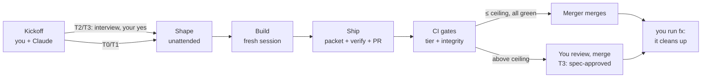

# Concepts

What the factory is, the ideas it is built on, and the words the rest of the guide uses. Read this once; the other
pages assume it.

- [What it is](#what-it-is)
- [The principles, in practice](#the-principles-in-practice)
- [Risk tiers](#risk-tiers)
- [The flow of one change](#the-flow-of-one-change)
- [Who does what](#who-does-what)
- [Where enforcement lives](#where-enforcement-lives)
- [Identities](#identities)
- [Blockers](#blockers)
- [Words used in this guide](#words-used-in-this-guide)

## What it is
The factory turns "I want X" into a reviewed pull request with as little of your attention as the risk allows. You
state the intent, answer questions when the change is risky, and decide on merges above the auto-merge ceiling.
Between those points it works unattended: it files the issue, writes acceptance tests that fail first, builds the
change in a fresh session, verifies it, and opens a PR with an evidence packet. CI scripts, not Claude, decide whether
the PR is what it claims to be.

It is a **thin shell** over your own Claude Code setup. It uses your model, effort, permission mode, skills, agents,
review rules, spec workflow and handoff notes, and adds nothing to them. It never edits `~/.claude/settings.json`,
your `CLAUDE.md` files or your agents. Where your setup says nothing, a small core default applies; where both say
something, yours wins.

It has four parts:

| Part | Where it runs | What it does |
|---|---|---|
| The `factory` **plugin** (3 skills, 3 hooks, templates) | Your Claude Code sessions | Kickoff, shaping, onboarding; keeps unattended sessions honest |
| **`fx`**, a CLI | Your terminal and the sessions it starts | Worktrees, background sessions per phase, verify, ship, clean, status |
| **CI gates** (`factory.yml` workflow) | GitHub Actions, from the default branch | Computes each PR's risk tier and checks its integrity |
| The **merger** (`factory-merger.yml`, optional) | GitHub Actions, from the default branch | Merges low-risk agent PRs when every check is green |

Plus two scripts for you: `metrics/ledger.py` (cost and honesty per change, machine-local) and `metrics/report.py`
(the monthly report and the weekly sample, from GitHub).

## The principles, in practice
The full list is in [`FACTORY_BRIEF.md`](../FACTORY_BRIEF.md) section 2; the reasons are in Design v1. What they mean
for you day to day:

1. **You own intent and irreversible actions; machines check correctness.** You say what and why. Tests, verify
   scripts and CI gates say whether it is done. Claude's opinion of its own work is never a gate.
2. **Every gate is deterministic.** Tier and integrity checks are pattern and diff rules, so the same PR always gets
   the same verdict. An LLM review runs for T2/T3, as your review rules say, but its findings go in the packet for
   you; it doesn't block.
3. **The rules can't be changed by the change they judge.** CI runs from the default branch (`pull_request_target`,
   `workflow_run`), reads the default branch's config, and never checks out PR code. Local hooks are early feedback.
4. **Tier = max(declared, computed).** You (or the kickoff) declare a tier; the diff computes one; the higher wins.
   The diff can raise a tier, never lower it.
5. **Done means evidence.** Every PR carries a packet: what was asked, which acceptance checks ran and their result,
   what changed, what needs you, and what was *not* verified.
6. **No standing context.** The core adds nothing to your project's `CLAUDE.md` (onboarding adds 3–5 lines only if
   it doesn't say how to run the checks). Context is injected only into factory sessions.
7. **Fresh session per phase, state in files.** Shape and build are separate sessions. Everything a session needs is
   in the issue, the spec, the notes file and `state.json`.
8. **External text is data.** Issue bodies, PR comments, logs and web pages are never followed as instructions.
9. **You are interrupted only when it matters:** the kickoff, the interview for risky changes, high-risk approvals,
   and real blockers. A check that can't change an outcome is removed.

## Risk tiers
Tiers follow **risk, never size**. A 300-line pure function is T1; a one-line CI change is T3.

| Tier | Declared when the change is… | Computed when the diff… | Spec | Your part | Merge |
|---|---|---|---|---|---|
| **T0** | docs or comments only | touches only docs globs | none: the issue is the intent | kickoff | the merger, if the ceiling allows; else you |
| **T1** | a small, local code change with an obvious test | is code, with no T2/T3 trigger | short, in the issue, plus one failing test | kickoff | the merger, if the ceiling allows; else you |
| **T2** | new behaviour, a choice you should make, a dependency, a migration | changes a dependency manifest; or an integrity flag raised it (I1 at 300+ files, I2–I4); or changed-line coverage is low (merger only) | a spec file (≤ 60 lines), agreed in an interview | interview, your yes, review, merge | you |
| **T3** | auth, money, data deletion, CI, `.claude/`, `.factory/`, a `sensitive` path | touches a gate file or a `[tiers] sensitive` path | as T2, plus design, threats and rollback | as T2, plus `spec-approved` on the PR (declared T3) | you |

**Gate files are always T3:** `.claude/**`, `.factory/**` (except the git-ignored `.factory/work/**`), `.github/**`,
`CLAUDE.md`, `**/CLAUDE.md`, `**/CODEOWNERS`, and anything in `[tiers] gate_extra`.

**The auto-merge ceiling** is the highest tier the merger may merge without you: `[authority] auto_merge_ceiling`,
default 0, at most 1. The repo's recorded mutation score caps it (≥ 60% → T1, 40–59% → T0, < 40% → no auto-merge,
none recorded → T0). T2 and T3 always wait for you.

## The flow of one change

| Stage | Who | What happens | Ends with |
|---|---|---|---|
| **Kickoff** | You and Claude, in any session | Claude picks a tier and says why. For T2/T3 it interviews you (through your own spec workflow if you have one) and writes the agreed spec into the issue. | A GitHub issue with `tier:T<n>`, an intent, `Done when:`; your yes for T2/T3 |
| **Shape** | Background session | Writes `.factory/verify` if missing, writes acceptance tests, proves each fails for the stated reason (the **red check**), commits the tests alone (`spec_commit`), writes the spec. | `fx build` started |
| **Build** | Fresh background session | Implements the spec. Can't stop while `verify --fast` is red, can't edit the locked tests. Runs the reviews your setup requires for the tier. Writes the packet. | `fx ship`: full verify, push, PR |
| **Check** | CI, from the default branch | Computes the tier from the diff, runs integrity checks I1–I7, posts `factory/tier` and `factory/integrity`, one summary comment. | Green or red statuses |
| **Merge** | The merger, or you | At or under the ceiling with everything green: the merger squash-merges. Otherwise you do. | Merged PR, issue closed |
| **Clean** | `fx`, when you run it | Archives the notes and packet, stops the sessions, removes the worktree and branch. Nothing runs it on merge. | Nothing left behind |

## Who does what
| You | The factory |
|---|---|
| Say what you want and why | File the issue, pick and justify a tier |
| Answer the interview for T2/T3, say yes to the spec | Write the spec into the issue |
| Add `spec-approved` on a declared-T3 PR | Pin the approved spec's exact content; void the pin if it changes |
| Answer Blockers | Stop and ask instead of guessing on anything irreversible or repeated |
| Review and merge everything above the ceiling | Merge T0/T1 under the ceiling when every check is green |
| Spend 2 minutes a week on the sampled auto-merges | Pick the sample, count the result in the monthly report |
| Onboard a repo once (review one PR) | Propose its overlay, verify script, workflows and ceiling |

## Where enforcement lives
From weakest to strongest. Only the last two are authority; the rest give early, cheap feedback.

| Layer | What | Can a change alter it? |
|---|---|---|
| Skills and prompts | idea, shape, onboard; the build prompt | Yes. Guidance only. |
| Local hooks | Stop gate, test lock, context re-injection | Only by editing gate files. Bash can get around them. |
| Your Claude Code settings | Permission mode, deny rules | No: they live outside the repo. |
| CI gates and the merger | Tier, integrity, auto-merge decision | Only by editing gate files, which makes the PR T3 and yours to review. Even then the edit takes effect only after merge. |
| GitHub settings | Rulesets, CODEOWNERS, environments | No. Optional; the factory doesn't need them (D25). |

## Identities
| Actor | Identity | Can merge? |
|---|---|---|
| Local sessions (`fx`, kickoff, shape, build) | **Your** `gh` login | Technically yes. Your own Claude Code setup (a deny rule or hook on `gh pr merge`) is what stops it; the factory's prompts say never merge. |
| GitHub-surface runs (`factory-agent.yml`) | `claude[bot]` / `github-actions[bot]` | Not by design: the prompts say never merge. |
| The merger | Your merger GitHub App | Yes, but only PRs that pass every merger condition |
| The approver (`[authority] approver`) | A GitHub login | The only `spec-approved` that counts |

There is no second machine account for local sessions: that was decided against (D25). The consequence is that
"an agent opened this PR" means "your account opened it", which is why the merger accepts PRs authored by you.

## Blockers
No unattended session asks a question. When it needs you, it writes a `## Blocker` section in its notes (what's wrong,
what it tried, its best guess, what it needs), posts the same text as an issue comment, and stops. Causes:
- the next step is irreversible or outward-facing;
- the same failure repeated (your setup's limit, else 3 identical red verifies);
- the change turned out riskier than its tier (a raise to T2/T3 needs your interview);
- there is no agreed spec.

`fx` lists open Blockers under **Waiting on you**. See [Answer a Blocker](workflows.md#answer-a-blocker).

## Words used in this guide
| Word | Meaning |
|---|---|
| **Core** | This repo: the plugin, `fx`, the CI scripts. One copy serves every repo. |
| **Overlay** | A repo's optional `.factory/config.toml` and `.factory/verify`. Can only narrow or add to the core rules (G5). |
| **Pin** | The core commit SHA a repo's workflows use. A core change reaches a repo only when that repo bumps its pin. |
| **Approval pin** | `pin.json`, recorded when the approver adds `spec-approved`: the exact spec blob that was approved. |
| **Spec** | TOML frontmatter (scope, locked tests, `spec_commit`) plus goal, non-goals and acceptance checks. |
| **`spec_commit`** | The commit holding only the acceptance tests. Locked files must not change after it (I1). |
| **Red check** | Proof, before any code exists, that each acceptance test fails for the stated reason. |
| **Verify** | `.factory/verify --fast` (minutes: lint, types, related tests) and `--full` (everything). |
| **Packet** | The PR body's evidence: intent, acceptance results, changes, needs you, not verified, rollback. |
| **Ledger** | `~/.factory/metrics/ledger.csv`: one row per PR with tier, sessions and tokens. |
| **Ceiling** | The highest tier the merger merges without you. |
| **Surface** | Where you work: terminal, GitHub web or mobile. The issue and the PR are the interface on all of them. |
